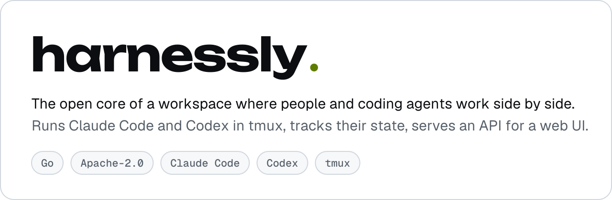
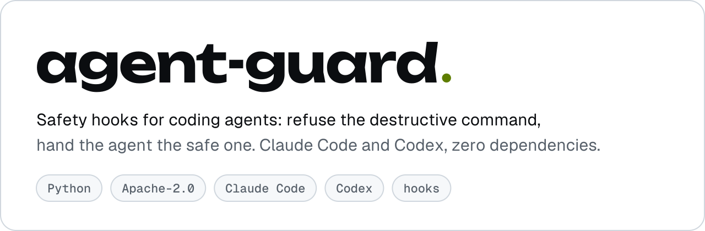
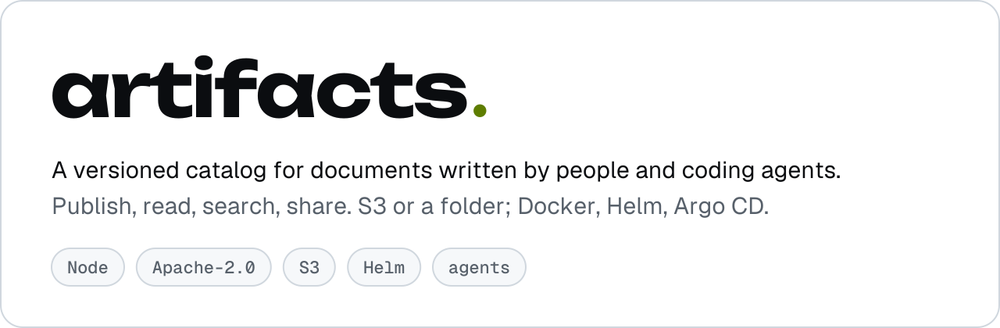
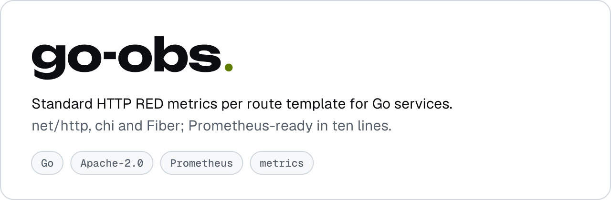

<picture>
  <source media="(prefers-color-scheme: dark)" srcset="assets/org-banner-dark.svg">
  
</picture>

 

Coding agents are becoming teammates. We build the open plumbing that lets them work next to people: run them,
watch them, hand them work and take it back — on your own machines, with nothing hidden.

 

<a href="https://github.com/ly-solutions/harnessly">
  <picture>
    <source media="(prefers-color-scheme: dark)" srcset="assets/card-harnessly-dark.svg">
    
  </picture>
</a>

 

<a href="https://github.com/ly-solutions/agent-guard">
  <picture>
    <source media="(prefers-color-scheme: dark)" srcset="assets/card-agent-guard-dark.svg">
    
  </picture>
</a>

<a href="https://github.com/ly-solutions/artifacts">
  <picture>
    <source media="(prefers-color-scheme: dark)" srcset="assets/card-artifacts-dark.svg">
    
  </picture>
</a>

<a href="https://github.com/ly-solutions/go-obs">
  <picture>
    <source media="(prefers-color-scheme: dark)" srcset="assets/card-go-obs-dark.svg">
    
  </picture>
</a>

 

**How we build**

- **Open by default.** Apache-2.0, developed in the open.
- **One binary.** Static Go builds with no runtime dependencies.
- **Proven, not promised.** Every rewritten piece is checked against recorded behaviour of the system it replaces.

Security reports: private vulnerability reporting on each project's <b>Security</b> tab.
