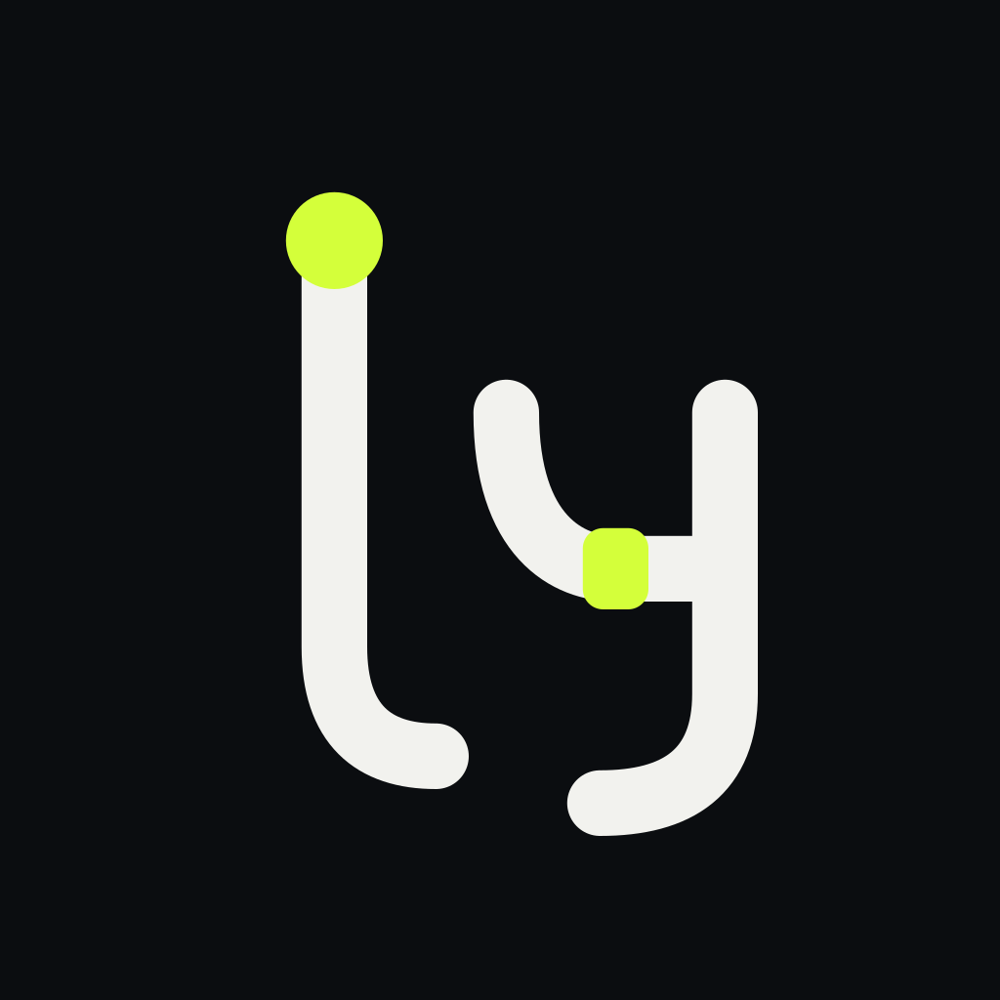

  

<h3 align="center">Ly Solutions</h3>

Open tools for people and coding agents working side by side.

---

### Projects

| | |
|---|---|
| **[harnessly](https://github.com/ly-solutions/harnessly)** | The open core of a workspace for Claude Code and Codex agents: the machine runtime and agent, in Go. Runs agents in tmux, tracks their state, and serves an API and sockets for a web UI. Apache-2.0. |

### Contributing

Issues and pull requests are welcome in each project. Security reports go through GitHub private vulnerability reporting on the project's **Security** tab.
